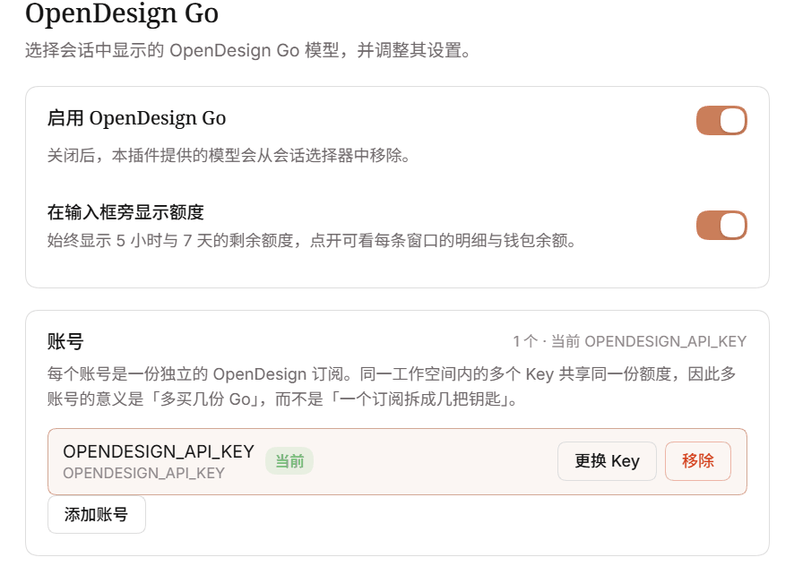
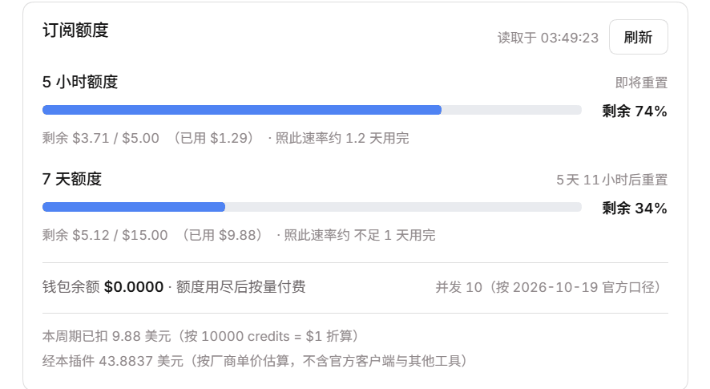
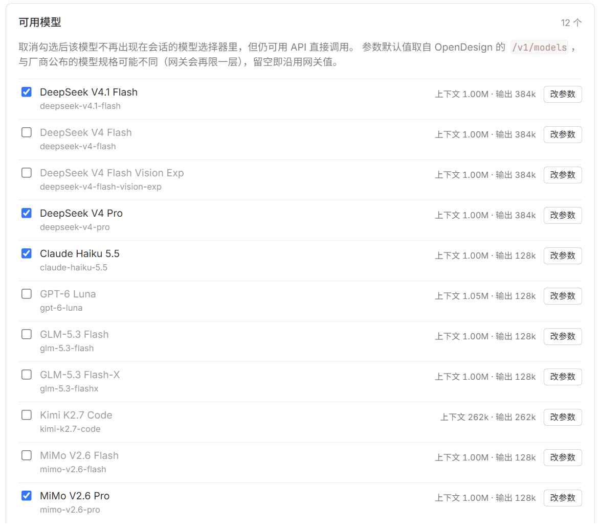

# OpenDesign Go for DSH

在 DSH 里使用 OpenDesign Go 订阅的 12 个模型：推理走 OpenAI Chat Completions 协议，额度、用量和多账号都在设置页里。



## 关于作者

交易员，业余写工具。这个插件起源于我自己拿 DeepSeek 做量化策略研究和复盘时的需要。

| 平台 | 地址 |
| --- | --- |
| 知乎 | [勇者别嚣张](https://www.zhihu.com/people/yong-zhe-bie-xiao-zhang) |
| YouTube | [@valortrader](https://www.youtube.com/@valortrader) |
| B站 | [勇者别嚣张的交易室](https://space.bilibili.com/10323235) |
| 微信公众号 | 勇者别嚣张的交易室 |

## 功能

| 功能 | 说明 |
| --- | --- |
| 接入 Go 套餐 | 注册一个 `dsh-opendesign-go` provider，提供 Design Plan 的 12 个模型 |
| 用量统计 | 记录每次经本插件发出的请求，按模型汇总输入/输出/缓存 token，并按各厂商公开单价估算成本 |
| 额度读取 | 勾选后调用本机 OpenDesign 桌面端自带的 `vela` 命令行，读取真实的 5 小时 / 7 天额度窗口 |
| 多账号 | 每个账号对应一份独立的 OpenDesign 订阅，每份一把 API Key；可开启失败自动切换 |
| 每模型参数 | 为单个模型覆盖上下文窗口与 `max_tokens` 上限 |
| 模型开关 | 取消勾选的模型不出现在会话的模型选择器里 |
| 图片输入 | 声明了 `image` 模态的模型可以接收图片；文本模型收到的是占位文本 |
| 工具读图 | `read_image` 读到的图片会随请求发给模型，不只回一段路径文本 |

所有用量数字都标注了口径。金额按官方公开价目表的**基础档**估算，超出阶梯阈值的长上下文请求会被低估；这不是账单，实际扣费以 OpenDesign 控制台为准。

多账号的要点：每个账号对应**一份独立的订阅**。同一工作空间内的多把 Key 共享同一份额度，所以多账号的意义是「多买几份 Go」，不是把一份订阅拆成多把钥匙。

## 适配与验证

下面这些结论都有对应的实测记录，不是「按文档应该能跑」。

| 项 | 结论 | 验证方式 |
| --- | --- | --- |
| 宿主版本 | `0.2.0-rc.1`、`0.2.0-rc.2`、`0.2.1-rc.2` 三版全部通过 | `npm run test:hosts`，每版在临时目录装齐 12 个 peer，再查符号 / 类型 / 挂载三层 |
| 网关上下文 | 真实窗口 1,048,576 token，未缩容 | 二分探测：喂 1,036,038 token 返 200，1,053,038 返 400 |
| 图片输入 | 声明 `image` 的 10 个模型全部能收图并正确识别 | 逐模型发同一张纯色 PNG，直连与经中间件两条链路各跑一遍 |
| 参数表 | 12 个模型的窗口与输出上限逐条对应厂商文档 | 出处逐条列在 [docs/models.md](docs/models.md) |
| 额度口径 | credits 与美元 10,000 : 1；5 小时 50,000、7 天 150,000 | 两个窗口独立折算互证，与 `vela` 输出一致 |
| 工具侧图片 | 图片改由紧随其后的 `user` 消息承载，直连与经中间件都到达模型 | 同一条工具结果在两种链路下逐模型比对 |

宿主兼容矩阵的三层是递进的，缺一层就会漏掉一类故障：**符号**抓导出被改名或删除（导入本身不报错，要到首次调用才炸），**类型**抓符号还在但签名漂移，**挂载**才是真实 Cordis 运行时接不接受入口。反向验证也做过——向产物注入不存在的导出会报 `thisExportDoesNotExist`，向源码写类型错误会报 `TS2322`，不会永远通过。

CI 有五个作业：Windows 与 Ubuntu 各跑 Node 24 和 22.19，加一个独立的 `hosts` 作业，当前全绿。

## 近期修复的缺陷

这些是实际撞到并定位到根因的问题，逐条记在这里，因为它们的现象都容易让人得出错误结论。

| 版本 | 现象 | 真实原因 |
| --- | --- | --- |
| 0.1.9 | 上下文只用了三成，请求却被判超长 | 网关按 `输入 + max_tokens ≤ 窗口` 判据，而插件每次把模型公布的最大输出（384,000）原样发上去；宿主只量输入，不扣输出预留量 |
| 0.1.8 | 工具读到的图片，模型说「看不到」 | 请求链路上的中间件按常见形状重建 `tool` 消息，把 content 拍平成字符串，`image_url` 部件被静默丢弃 |
| 0.1.7 | 同上，模型说「看不到图片」 | 我们自己处理 `tool` 角色时把图片解析器传成了 `undefined`，每张图被替换成占位文本 |
| 0.1.7 | 插件市场安装长时间等待甚至超时 | 每次调用都无条件 `settings.update`，宿主会锁住 profile 根目录并重写整份 composition 文档，随后重算插件树 |
| 0.1.6 | 所有模型都被判成不能识图 | 模态字段读错了表：宿主读的是 `catalog.ts` 的静态目录，而那张表只有 id 和 name |
| 0.1.5 | 历史回放在部分 Node 24 上重复计数 | 会话日志一个事件一帧，旧读法依赖「一次解码只返回第一帧」；部分构建会连带后面的帧 |

对应的修法：

- **输出预留**（0.1.9）。报给宿主的窗口改成**输入预算** `窗口 − max(输出上限, 窗口/4)`，1M 窗口 + 384K 输出的模型报 750,000；真正发出的 `max_tokens` 按本次请求的实际输入钳制，输入占满时省略该字段。图片按每张 1,024 token 计——按 base64 长度算会高估三个数量级。工具声明也计入：本机真实工具集是 326 个声明、约 163K token，占窗口 15.6%。
- **工具侧图片**（0.1.7 → 0.1.8）。先是让 `tool` 消息也走图片解析器，之后发现 `tool` 角色承载非文本部件缺乏共识——Chat Completions 规范没有约定它，各家重建实现各行其是。现在 `tool` 消息只发文本，图片提取到紧随其后的 `user` 消息，并由一句 `(Image content from the preceding tool result.)` 标明来源。
- **配置写入**（0.1.7）。写入前先读该 entry 当前的值，相等就直接返回；短路放在重试循环内部，每次重写前重新读，`revision` 围栏语义不变。写入失败不再死重试 12 次，只有 `SETTINGS_CONFLICT` 值得重试一次。加上 5 分钟节流，实测写入量从约 1814 + 1440 次/天降到各 288 次/天。
- **模态来源**（0.1.6）。删掉 `catalog.ts` 里那份会分叉的模态字段，会话选择器、参数解析、请求门控统一读 `MODEL_DEFAULTS`。测试强制把 12 个模型分进「支持图片」与「仅文本」两组，并要求并集等于全集，漏写一个就失败。
- **帧解压**（0.1.5）。改为按帧边界切片，一片一帧，与运行时是否连帧无关。本机的 zstd 不连帧、无法复现，所以把解码器做成可注入参数，测试用一个「会连帧」的模拟解码器验证。

## 示意图

订阅额度卡片，两个滚动窗口各自的剩余百分比、剩余金额与已用金额：



可用模型列表，取消勾选即从会话的模型选择器移除，也可逐项改参数：



## 安装

这是 DSH 插件，需要 DSH 桌面端 `>= 0.2.0-rc.1`（见 `package.json` 的 `engines`）。

**从 npm 安装（推荐）**，在 DSH 桌面端的插件管理界面里填包名：

```
dsh-opendesign-go
```

装完重启桌面端，在设置里打开「OpenDesign Go」分区。

**非桌面端 profile**（例如 `web`）也可以用命令行：

```bash
dsh plugin --profile web add dsh-opendesign-go
```

升级到最新版：

```bash
npm install -g dsh-opendesign-go@latest
```

### 为什么推荐 npm 而不是 GitHub

npm 包把构建产物和依赖版本一起锁定。GitHub 方式也能用（填 `github:EliteOtaku/dsh-opendesign-go`），但有两个代价：

- **依赖会更慢、更易受上游变动影响**：GitHub 安装走 git 解析，拿到的是默认分支 HEAD，不是某个固定版本。
- **npm v12 起 git 依赖默认不再解析**。自 npm 12 起 `--allow-git` 默认为 `none`，除非显式允许，`github:` 形式的依赖会被跳过。npm 包不涉及这条限制。

构建产物 `lib/` 同时提交在仓库里，所以两条路径都不需要在本机构建。

> 桌面端的 `desktop` profile 由 Electron 应用独占管理：依赖和 `dsh.profile.bundles` 条目是分开落地的，命令行 `dsh plugin add` 只写其中一部分，结果通常是一半安装（启动报 `cannot resolve profile bundle`，或者插件静默不加载）。所以 desktop profile 请用插件管理界面，不要用命令行。

## 配置

配置写在插件自己的 profile 条目 `opendesign-go` 下，命名空间为 `llm-opendesign-go`。所有字段都是 `volatile()` 引用，改完即时生效，不需要重启。

设置页直接可改的是：启用开关、额度来源、账号列表（含每账号的 `workspaceId`）、模型开关、每模型参数、对账基准。其余字段（`apiKeyEnv`、`baseURL`、`requestTimeoutMs`、`streamIdleTimeoutMs`、`autoSwitch`、`sessionRef`、`workspaceId`、`planOverrides`、`recoveredEnabled`、`recoveredProviders`）目前需要编辑 profile 条目的 config 块。

| 配置项 | 默认值 | 用途 |
| --- | --- | --- |
| `enabled` | `true` | 关闭后插件提供的模型从会话选择器中移除 |
| `apiKeyEnv` | `OPENDESIGN_API_KEY` | 凭据引用名。插件按这个名字向 DSH 凭据服务（或启动环境变量）取 API Key，配置里不放密钥明文 |
| `accounts` | `[]` | 账号列表，每项含 `id`、`name`、`apiKeyEnv`、可选 `workspaceId`。第一项是当前账号，顺序即故障切换顺序；上限 20 个 |
| `autoSwitch` | `false` | 开启后，当前账号遇到凭据被拒或额度耗尽时按列表顺序尝试下一个账号 |
| `useVelaCredential` | `false` | 用本机 OpenDesign 桌面端的登录态读取额度，无需另填凭据 |
| `sessionRef` | `''` | 使用控制台会话读取额度时的凭据引用名（`OPENDESIGN_SESSION`）。仅在不用 `vela` 且需要控制台通道时填写 |
| `workspaceId` | `''` | 控制台通道的工作空间 ID；`vela` 通道会自动探测，一般留空 |
| `baseURL` | `https://amr-link.open-design.ai/v1` | 推理网关基址。不能带查询串或片段，末尾斜杠会被去掉 |
| `requestTimeoutMs` | `1800000` | 单次请求的总超时（30 分钟） |
| `streamIdleTimeoutMs` | `300000` | 流式读取的空闲超时声明值。当前实现只用 `requestTimeoutMs` 判定超时 |
| `enabledModelsJson` | `''` | 启用的模型 ID 数组（JSON 字符串）。空值表示全部启用 |
| `modelParamsJson` | `''` | 每模型参数覆盖（JSON 字符串），形如 `{"kimi-k2.7-code":{"contextWindow":262144,"maxTokens":131072}}` |
| `planOverrides` | `''` | 套餐额度覆盖，格式 `go:150,plus:200`。只改额度上限，不改月费 |
| `alignBaselineJson` | `''` | 对账基准点（JSON），由设置页的「对齐当前周期」写入 |
| `recoveredEnabled` | `false` | 是否从本机会话日志补算未经本插件的 OpenDesign 调用 |
| `recoveredProviders` | `''` | 补算时计入的 provider 名，逗号分隔；空值用 `opendesign,dsh-opendesign-go` |

另外三个字段 `usageJson`、`reportJson`、`diagnosticsJson` 是插件写入的缓存与诊断信息，设置页只读，不建议手改。

完整的字段语义、取值约束和示例见 [docs/configuration.md](docs/configuration.md)。

### 凭据

API Key 保存在 DSH 凭据服务里，设置页只显示引用名，不回显已保存的密钥。首次使用时有两种方式：

- 在设置页的「账号」卡片里添加账号，Key 由插件自动分配引用名（`OPENDESIGN_ACCOUNT_<n>`）；
- 或在启动环境里设置 `OPENDESIGN_API_KEY`，用默认引用名。

### 额度读取

勾选「使用本机 OpenDesign 的登录凭证读取额度」后，插件会查找本机 OpenDesign 桌面端自带的 `vela`：

- Windows：`%LOCALAPPDATA%\Programs\Open Design\resources\open-design\bin\vela.exe`
- macOS：`/Applications/Open Design.app/Contents/Resources/open-design/bin/vela`
- Linux：`~/.local/share/open-design/bin/vela`

也支持环境变量 `OPENDESIGN_VELA_PATH` 指定路径。查找顺序是：环境变量 → 官方安装目录 → `PATH`。官方安装目录优先于 `PATH`，因为只有它共享桌面端的登录态。

`vela` 是官方私有命令行，不是公开契约。插件会校验它输出的每个字段：格式变了就显示失败原因，不会给出一个看似正常的错误数字。

详见 [docs/quota.md](docs/quota.md)。

## 模型

Go 套餐授予 12 个 Design Plan 模型。默认参数取自各厂商文档，可在设置页逐项覆盖。

| 模型 | ID | 上下文 | 输出上限 | 图片输入 |
| --- | --- | --- | --- | --- |
| DeepSeek V4.1 Flash | `deepseek-v4.1-flash` | 1,000,000 | 384,000 | 支持 |
| DeepSeek V4 Flash | `deepseek-v4-flash` | 1,000,000 | 384,000 | 支持 |
| DeepSeek V4 Flash Vision Exp | `deepseek-v4-flash-vision-exp` | 1,000,000 | 384,000 | 支持 |
| DeepSeek V4 Pro | `deepseek-v4-pro` | 1,000,000 | 384,000 | — |
| Claude Haiku 5.5 | `claude-haiku-5.5` | 1,000,000 | 128,000 | 支持 |
| GPT-6 Luna | `gpt-6-luna` | 1,050,000 | 128,000 | 支持 |
| GLM-5.3 Flash | `glm-5.3-flash` | 1,000,000 | 128,000 | 支持 |
| GLM-5.3 Flash-X | `glm-5.3-flashx` | 1,000,000 | 128,000 | 支持 |
| Kimi K2.7 Code | `kimi-k2.7-code` | 262,144 | 262,144 | 支持 |
| MiMo V2.6 Flash | `mimo-v2.6-flash` | 1,000,000 | 128,000 | 支持 |
| MiMo V2.6 Pro | `mimo-v2.6-pro` | 1,000,000 | 128,000 | 支持 |
| Hunyuan H4 Preview | `hy4-preview` | 1,000,000 | 64,000 | — |

说明：

- `deepseek-v4-flash` 与 `deepseek-v4-flash-vision-exp` 是已退役的 ID，官方文档说明两者都由 DeepSeek-V4.1-Flash 承接，因此参数与图片能力都沿用 V4.1-Flash。`deepseek-v4-pro` 是另一个模型，官方价格表对它的「图像理解」标的是不支持。
- 覆盖值的允许范围：上下文窗口 1,000–10,000,000，输出上限 1–1,000,000。越界会被拒绝并提示，不会静默截断。
- 请求没有显式给出 `maxTokens` 时，插件用上表的输出上限作为 `max_tokens`，**再按本次请求的实际输入钳制**——网关要求 `输入 + max_tokens ≤ 窗口`，不钳制就会在长对话里被拒。
- 设置页的模型行会同时显示「可用输入」，即 `窗口 − max(输出上限, 窗口/4)`。改 `max_tokens` 时能立刻看到自己拿多少输入去换了多少输出。
- 思考等级按模型给出，取自网关对每个模型实际接受的集合，见 [docs/models.md](docs/models.md)。
- **「图片输入」一列取自 `src/model-params.ts` 的 `MODEL_DEFAULTS`**，厂商文档是唯一依据，出处逐条列在 [docs/models.md](docs/models.md)。会话选择器、参数解析和请求门控都读这张表，因此列表里显示的图片能力与实际能否发送图片一致。文本模型收到图片时会得到占位文本，不会把图片字节发给网关。

更多细节见 [docs/models.md](docs/models.md)。

## 套餐结构说明

Go 档月费 $10，官方宣传「每月最高额度 $120」。实际约束是两个滚动窗口：

| 窗口 | 额度 | 折算 |
| --- | --- | --- |
| 5 小时 | 50,000 credits | $5 |
| 7 天 | 150,000 credits | $15 |

（credits 与美元的换算是 10,000 credits = $1。）

这两个窗口决定了月额度按周窗口的费率用不满：一个 7 天窗口 $15，四周左右合计约 $65，离宣传的 $120 还差一半。**这不是插件或网关的 bug**，是套餐本身的结构——$120 是宣传口径的上限，实际可用量由 5 小时和 7 天两个窗口共同约束。

插件不预测月消耗，只回答能操作的问题：「照当前速度，这个窗口会不会在重置前用完？」从周窗口线性外推月消耗只会报出约一半的宣传额度，看起来像有富余，实际并不存在。

## 文档

- [配置项参考](docs/configuration.md)
- [模型与参数](docs/models.md)
- [额度、用量与套餐结构](docs/quota.md)
- [开发与排障](docs/development.md)
- [更新记录](CHANGELOG.md)

## License

MIT，见 [LICENSE](LICENSE)。Copyright (c) 2026 EliteOtaku。

[](https://github.com/deepseek-ai/deepseek-harness)
